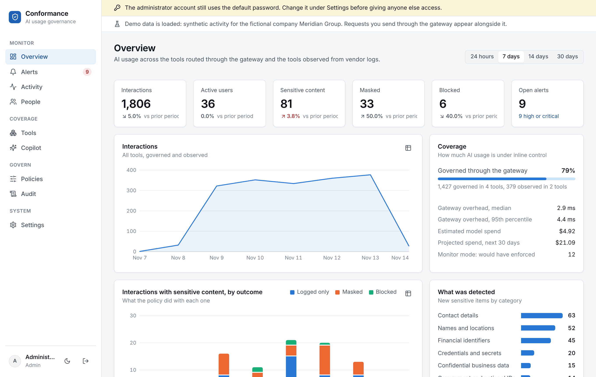
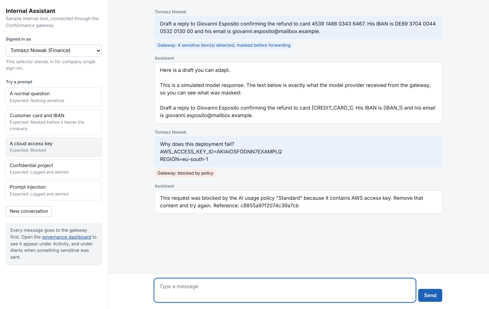
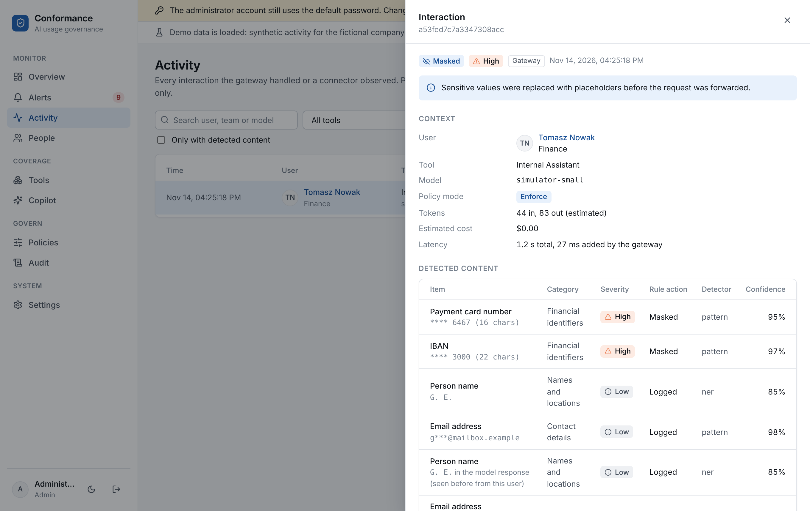
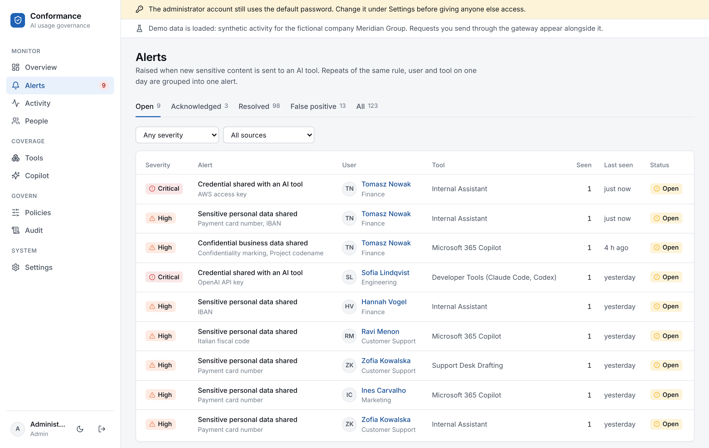
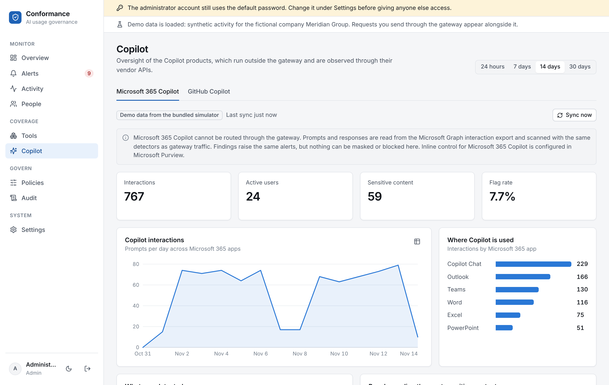
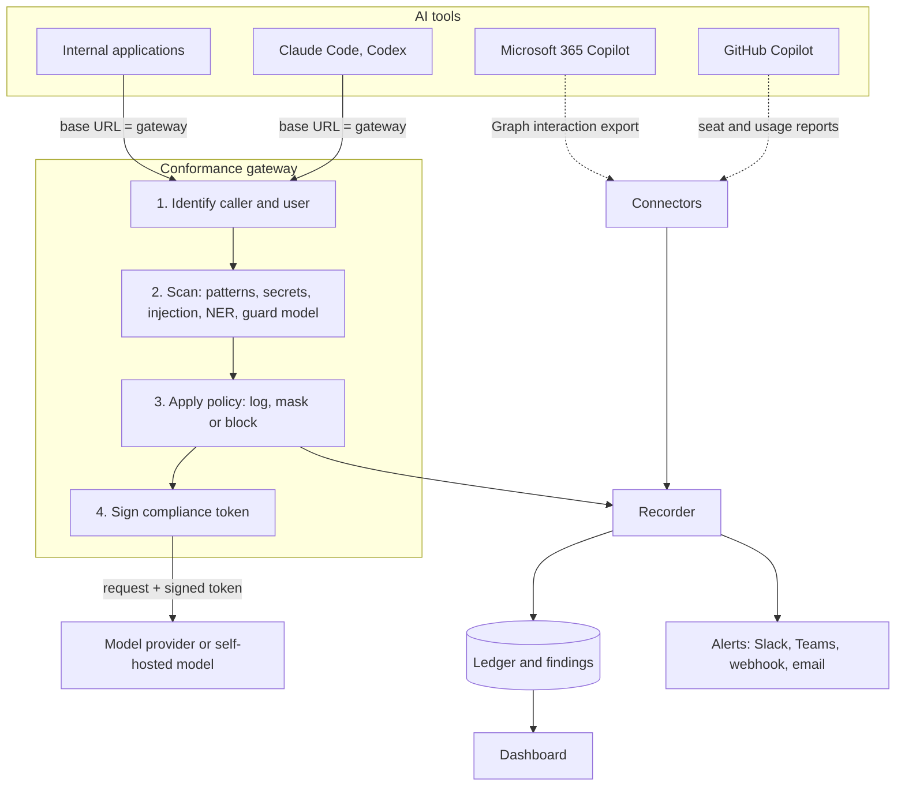

# Conformance

AI usage governance for companies: one gateway that every AI request passes through, and one dashboard that shows who used which tool, what sensitive data was involved, and what the policy did about it.

Conformance does three things:

1. **Governs** the AI tools you can route: internal applications, Claude Code, Codex and anything else that speaks the OpenAI or Anthropic API. Requests are scanned inline and logged, masked or blocked according to policy.
2. **Observes** the AI tools you cannot route: Microsoft 365 Copilot and GitHub Copilot. Their vendor logs are imported and, where content is available, scanned with the same detectors.
3. **Proves** what happened: every interaction is written to a signed, hash-chained ledger, and every forwarded request carries a signed compliance token that downstream services can verify.



| Sample internal tool: masked and blocked requests | Interaction detail: redacted prompt and findings |
|---|---|
|  |  |
| **Alert inbox** | **Copilot oversight** |
|  |  |

## Contents

- [How it works](#how-it-works)
- [Quick start](#quick-start)
- [Try it in ten minutes](#try-it-in-ten-minutes)
- [Connect a real internal tool](#connect-a-real-internal-tool)
- [What is in the box](#what-is-in-the-box)
- [Documentation](#documentation)
- [Verification status](#verification-status)
- [Repository layout](#repository-layout)

## How it works



A request from a governed tool takes this path:

1. The tool calls the gateway instead of the model provider. This is a one-line change: the base URL.
2. The gateway identifies the application from its key and the employee from the identity the application asserts, from a personal key, or from an SSO token.
3. The detectors scan the request. On a typical prompt this adds 2 to 5 ms.
4. The tool's policy decides per category: ignore, log, mask or block. In monitor mode nothing is changed and the dashboard shows what enforcement would have done.
5. The gateway forwards the (possibly masked) request with a signed token that binds the verdict to the exact bytes sent.
6. The interaction is recorded with redacted text only, chained into the ledger, and evaluated against the alert rules.

Tools that cannot be routed are covered by connectors that poll the vendor APIs. They appear in the same dashboard, marked as observed.

## Quick start

Requirements: Docker with the Compose plugin (Compose 2.24 or newer), about 4 GB of free memory and 3 GB of disk.

```bash
git clone https://github.com/m-zest/conformance_v2.1.git
cd conformance_v2.1
docker compose up -d --build
```

The first build takes a few minutes. The first start then loads two weeks of synthetic demo activity, which takes about 30 seconds. Check progress with `docker compose ps`: the stack is ready when `gateway` is healthy.

| What | Address | Notes |
|---|---|---|
| Dashboard | http://localhost:8080 | Sign in with `admin@meridian.example` and `ChangeMe-Pilot-2026` |
| Sample internal tool | http://localhost:8090 | A chat assistant that calls the gateway |
| Gateway API | http://localhost:8000 | What AI tools are pointed at |
| Simulator | http://localhost:9000 | Stand-in for the model provider and the vendor APIs |

On a server, replace `localhost` with the server address and set `DASHBOARD_URL` and `GATEWAY_PUBLIC_URL` in `.env` accordingly.

No model provider key is needed for the demo. The simulator answers in place of a real model and echoes what it received, so you can see exactly what was masked.

To stop: `docker compose down`. To delete all data: `docker compose down -v`.

For a pilot without the demo content, the simulator and the sample tool, use the override file `docker-compose.pilot.yml` as described in [docs/INSTALL.md](docs/INSTALL.md#4-from-demo-to-pilot).

## Try it in ten minutes

1. **Open the sample tool** at http://localhost:8090. Pick an employee in "Signed in as" and click the sample prompts on the left:
   - *A normal question* is forwarded unchanged.
   - *Customer card and IBAN* is masked. The reply shows that the model received `[CREDIT_CARD_1]` and `[IBAN_1]` instead of the real values.
   - *A cloud access key* is blocked. The request never leaves the gateway.
   - *Confidential project* and *Prompt injection* are forwarded and raise alerts.
2. **Open the dashboard** at http://localhost:8080.
   - **Activity** shows your requests at the top. Click one to see the redacted prompt, the findings and the ledger entry.
   - **Alerts** shows the alerts your prompts raised. Open one, add a note and resolve it.
   - **People** ranks employees by risk. Open a person to see their history.
   - **Policies** has a "Test a prompt" box: paste any text to see what the detectors find and what each policy would do, without storing anything.
   - **Copilot** shows the Microsoft 365 Copilot and GitHub Copilot views, fed by the simulator in demo mode.
   - **Audit** has "Verify ledger", which recomputes the whole hash chain.
3. **From the command line**, `./scripts/send-examples.sh` sends the same kinds of request with curl and prints the gateway's decision headers. The last step calls the model provider directly, without the gateway, and is rejected because it carries no compliance token.
4. **Switch a policy to monitor mode** under Policies and repeat a sample prompt. It is now forwarded unchanged and reported as "Would mask" or "Would block". This is how a rollout starts.

## Connect a real internal tool

1. Put your provider details in `.env` (copy `.env.example`), for example:

   ```bash
   OPENAI_BASE_URL=https://api.openai.com/v1
   OPENAI_API_KEY=<your provider key>
   ```

   Azure OpenAI, Anthropic and self-hosted OpenAI-compatible servers are configured the same way. Restart with `docker compose up -d`.
2. In the dashboard, open **Tools**, choose **Register tool**, and assign the "Monitor only" policy.
3. Open the tool, create a key and copy it. It is shown once.
4. In your tool, change two values:

   ```text
   before:  base_url = https://api.openai.com/v1      api_key = <provider key>
   after:   base_url = http://<gateway>:8000/v1       api_key = <gateway key>
   ```

5. Have the tool send the signed-in user with each call:

   ```text
   X-End-User: name@company.com
   X-End-User-Name: Full Name          (optional)
   X-End-User-Team: Department         (optional)
   ```

That is the whole integration. `sdk/examples/internal_tool_openai.py` shows it with the OpenAI SDK and `demo-app/app.py` is a complete working tool. Users do not get keys and do not notice the gateway unless a request is blocked.

For Claude Code, Codex, Microsoft 365 Copilot and GitHub Copilot see [docs/INTEGRATIONS.md](docs/INTEGRATIONS.md).

## What is in the box

| Area | What you get |
|---|---|
| Gateway | OpenAI chat completions, OpenAI responses and Anthropic messages endpoints, with streaming |
| Detection | Checksum-validated PII patterns, credential formats with an entropy check, prompt injection heuristics, custom terms, optional Presidio NER, optional Llama Guard |
| Policy | Per-tool policies with an action per category and a monitor or enforce mode. Versioned, with a dry-run bench |
| Identity | Application keys with asserted users, personal keys, OIDC tokens from your identity provider |
| Privacy | Prompts are stored redacted or not at all. Alerts and notifications never contain the sensitive value |
| Alerts | Rules for credentials, sensitive personal data, confidential data, injection and volume. Deduplicated. Slack, Teams, webhook, email |
| Audit | Hash-chained ledger signed with ECDSA P-256, tamper detection, CSV and JSON export, administrative action log |
| Signing | ES256 compliance token bound to the forwarded body, JWKS endpoint, verifier in `sdk/` |
| Copilot | Microsoft 365 Copilot connector with content scanning, GitHub Copilot connector for seats and usage |
| Dashboard | Overview, alerts, activity, people, tools, Copilot, policies, audit, settings. Light and dark themes |
| Operations | Docker Compose, Postgres, non-root containers, health checks, retention, role-based access |

## Documentation

| Document | Read it when |
|---|---|
| [docs/INSTALL.md](docs/INSTALL.md) | You are installing on a server, configuring it, or moving from demo to pilot |
| [docs/ARCHITECTURE.md](docs/ARCHITECTURE.md) | You want to understand the components, data model and security design |
| [docs/INTEGRATIONS.md](docs/INTEGRATIONS.md) | You are connecting an internal tool, Claude Code, Codex, Microsoft 365 Copilot or GitHub Copilot |
| [docs/DETECTION.md](docs/DETECTION.md) | You want to know what is detected and how, including regex versus Llama Guard, and how to tune it |
| [docs/PILOT.md](docs/PILOT.md) | You are planning the pilot: phases, roles, success criteria, legal prerequisites |
| [docs/ROADMAP.md](docs/ROADMAP.md) | You want to know what is deliberately not built yet, including TEE and HSM support |

## Verification status

What has been verified in this repository and what has not:

| Item | Status |
|---|---|
| Backend test suite (`make test`, 36 tests) | Passing. Covers detection, the proxy path on all three protocols, streaming, policies, keys, alerts, ledger tamper detection, and both connectors against the simulator |
| Full Docker Compose stack | Built and run end to end, including the sample tool and the dashboard |
| Named entity detection | Run with Presidio and `en_core_web_sm` |
| Real model providers | The proxy path is provider-agnostic and tested against the simulator, which implements the OpenAI and Anthropic wire formats. It has not been run against the live OpenAI, Azure or Anthropic APIs in this repository |
| Microsoft 365 Copilot connector, live mode | Written against the Microsoft Graph documentation and tested against the simulator. Not yet run against a real tenant |
| GitHub Copilot connector, live mode | Same: tested against the simulator only. GitHub revised its Copilot metrics API in 2026, so check the report path against the current REST reference (see the integrations guide) |
| Llama Guard profile | The integration code is unit tested. The Ollama container and model were not started in the test environment |

Run the first live connection of each kind with someone who can read the gateway log (`docker compose logs -f gateway`).

## Repository layout

```text
backend/        Gateway and dashboard API (FastAPI, SQLAlchemy)
  app/gateway/      protocol adapters, identity, the proxy path
  app/detection/    detectors and the scan engine
  app/connectors/   Microsoft 365 Copilot and GitHub Copilot
  app/api/          dashboard API
  tests/            pytest suite
frontend/       Dashboard (React, TypeScript, Vite)
simulator/      Mock model provider and mock vendor APIs, for testing only
demo-app/       Sample internal tool
demo/           Synthetic roster, prompt corpus and value generators
sdk/            Compliance token verifier and integration examples
scripts/        Example requests
docs/           Guides
latex/          Research papers that preceded this implementation
```

## Development

```bash
pip install -r backend/requirements-dev.txt
make test                       # backend tests, SQLite, no Docker needed

cd frontend && npm install && npm run dev     # dashboard on :5173, proxies /api to :8000
```

## License

Apache 2.0.
