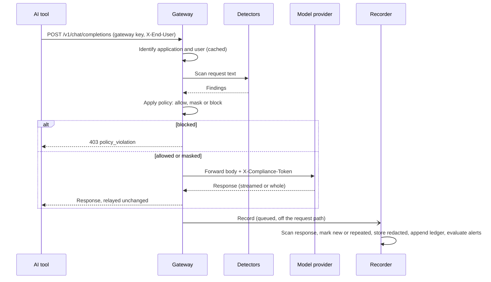

# Architecture

This document describes how Conformance is built: the components, the path a request takes, the data that is stored, and the security properties each part provides.

## Components

| Component | Role | Technology |
|---|---|---|
| Gateway | Receives requests from AI tools, scans them, applies policy, signs and forwards them | Python, FastAPI, httpx |
| Dashboard API | Read and management API behind the dashboard. Same process as the gateway | FastAPI, SQLAlchemy |
| Dashboard | Web interface for monitoring, triage and administration | React, TypeScript, served by nginx |
| Database | Interactions, findings, alerts, policies, ledger | PostgreSQL (SQLite for tests and single-file trials) |
| Connectors | Import vendor logs for tools that cannot be routed | Background tasks in the gateway process |
| Simulator | Mock model provider and vendor APIs | Testing and demos only |

The gateway and the dashboard API share one process and one port. The dashboard container proxies `/api` to it. AI tools call `/v1/...` on the gateway directly.

## Coverage model

Not every AI tool can be controlled in the same way. Conformance is explicit about which tier a tool is in.

| Tier | Tools | Mechanism | Control |
|---|---|---|---|
| Governed | Internal applications, Claude Code, Codex, any client with a configurable API endpoint | Traffic passes through the gateway | Log, mask, block. Real time |
| Observed with content | Microsoft 365 Copilot | Connector reads prompts and responses from the vendor's export API | Detection and alerts after the fact. No blocking |
| Observed, usage only | GitHub Copilot | Connector reads seat and usage reports | Adoption and licence oversight. No content |
| Not covered | Personal accounts on public AI websites | Outside this product. Use the web proxy or CASB you already have | Discovery and network-level blocking |

The dashboard shows the split on the overview page (share of interactions under inline control) and marks every record as governed or observed.

## Request path



Design points:

- **The request path does no database writes.** Application keys, users and policies are cached in memory for a few seconds. Persisting the interaction happens on a queue after the response is on its way. Measured overhead for the scan and policy step is 2 to 5 ms on typical prompts.
- **Streaming is relayed byte for byte.** The gateway reads the event stream on the side to capture the output and the token usage. It does not buffer or rewrite it.
- **Unchanged requests are forwarded as the original bytes.** The body is re-serialised only when something was masked.
- **Conversation history is handled.** Chat clients resend the whole conversation on each turn. The gateway scans and masks all of it, with a scan cache so repeated segments cost nothing, and keeps a keyed fingerprint of each sensitive value per user. A value that was already seen is recorded as a repeat. Alerts and risk scores count new exposure only.

## Detection

Detection is layered. Cheap deterministic layers run on everything. Model-based layers are optional and bounded.

| Layer | Finds | Method | Typical cost |
|---|---|---|---|
| PII patterns | Cards, IBANs, national IDs, contact details, confidentiality markings | Regular expressions with checksum and context validation | Well under 1 ms |
| Credentials | Cloud keys, tokens, private keys, connection strings, generic secrets | Provider formats plus an entropy check on assignments | Well under 1 ms |
| Injection | Instruction override, prompt extraction, role hijack | Weighted heuristic signals | Well under 1 ms |
| Custom terms | Code names, internal identifiers | Keywords and regular expressions per policy | Well under 1 ms |
| Named entities | People and places | Presidio with a spaCy model, applied to new content only | 5 to 30 ms |
| Guard model | Unsafe requests by hazard category | Llama Guard on your own hardware | 100 ms to 2 s, off the request path by default |

[DETECTION.md](DETECTION.md) covers each layer, why both regular expressions and a guard model are needed, and how to tune them.

## Policy

A policy maps each category to one action:

| Action | Effect on the request | Recorded |
|---|---|---|
| Ignore | None | Nothing |
| Log | Forwarded unchanged | Finding, and an alert if a rule matches |
| Mask | The value is replaced by a placeholder such as `[IBAN_1]`, consistent within the request | Finding with the action taken |
| Block | Rejected with HTTP 403 and a message naming what to remove | Finding with the action taken |

Each policy has a mode. In **monitor** mode no request is changed and the record shows what enforcement would have done. In **enforce** mode the actions are applied. Every tool is assigned one policy, so a rollout can enforce on one tool while another is still being measured.

Policies are versioned. Each change records who made it and what changed, and each interaction records the policy version that judged it.

Responses from the model are scanned too. In this version response findings are recorded and can raise alerts, but responses are not modified.

## Identity

| Method | Used by | How the user is established |
|---|---|---|
| Application key with asserted user | Internal web applications | The application authenticates with its key and sends the signed-in user in `X-End-User`. The application must be registered as trusted |
| Personal key | Developer tools, scripts | The key itself is bound to one user |
| OIDC token | Developer tools with SSO | A JWT from your identity provider, verified against its published keys |

Keys are stored as SHA-256 hashes and shown once at creation. Requests from a trusted application that does not name a user are recorded under an "Unattributed" identity for that tool, which makes the gap visible instead of hiding it.

## Compliance signing

After a request passes policy, the gateway issues a short-lived ES256 token and attaches it as `X-Compliance-Token`:

| Claim | Meaning |
|---|---|
| `iss`, `aud`, `iat`, `exp` | Issuer, intended audience, validity window (120 seconds by default) |
| `jti` | The interaction ID, which is also the ledger record ID |
| `sub`, `app` | Internal user ID and tool identifier |
| `pol` | Policy ID, version and mode |
| `dec` | The decision: `allowed` or `masked` |
| `bh` | Base64url SHA-256 of the exact body that was forwarded |

A service that trusts the gateway's public key (`/.well-known/jwks.json`) can verify the token instead of running its own checks: the signature proves the gateway issued it, `bh` proves the body was not altered afterwards, and `exp` limits replay. The token contains no prompt content. `sdk/conformance_verifier.py` is a small verifier. The simulator uses it and rejects any request that arrives without a valid token, which demonstrates that the provider can be closed to traffic that bypasses the gateway.

This only has force for services you operate: self-hosted models, MCP servers, internal APIs. Public model providers do not verify third-party tokens.

The signing key is an ECDSA P-256 key stored in the gateway's data volume. Moving it into a KMS or HSM, and running the checker in a trusted execution environment, are on the [roadmap](ROADMAP.md).

## Audit ledger

Every interaction record and every administrative action is appended to a ledger:

```text
entry_hash = SHA-256(prev_hash | seq | record_type | record_id | payload_hash)
```

`payload_hash` covers the fields that matter for an audit: who, which tool, which model, the decision, the number of findings, the hash of the forwarded body, and the policy version. Each entry is signed with the gateway key.

Verification (the Audit page, or `python -m app.cli verify-ledger`) walks the chain and reports:

- a missing or reordered entry
- an entry whose hash no longer matches its contents
- an invalid signature
- a stored interaction that was edited after it was written

Retention deletes interaction records after the configured period. Ledger entries are kept, so the chain stays verifiable.

A hash chain kept in the same database detects tampering by anyone who cannot also rewrite the whole chain and re-sign it. For stronger guarantees, export the head hash to a separate system on a schedule.

## Alerts

Alert rules run when an interaction is recorded, for gateway traffic and for connector imports alike.

- Rules match new findings by category and minimum severity. One rule watches volume: many distinct personal data items from one user in a short window.
- Alerts are grouped by rule, user, tool and day. A second occurrence increments a counter instead of opening a new alert.
- Notifications go to Slack, Microsoft Teams, a generic webhook and email. They contain the title, severity, user, tool and a link. They never contain the value or the prompt.
- History imported by a connector on its first run does not trigger notifications.

## Data model

| Table | Content |
|---|---|
| `users` | Monitored employees: identifier, name, team, title |
| `applications`, `api_keys` | Registered tools and their hashed keys |
| `policies` | Rules, custom terms, mode, version |
| `requests` | One row per interaction: metadata, decision, tokens, cost, latency, redacted text, hashes |
| `findings` | One row per detected item: category, type, severity, action, masked preview, fingerprint |
| `seen_fingerprints` | Keyed hashes of values already seen per user |
| `alerts`, `alert_events`, `alert_rules`, `notifications` | Alerting |
| `ledger`, `ledger_head`, `audit_log` | Tamper-evident trail and administrative actions |
| `connectors`, `copilot_seats`, `copilot_usage_daily` | Connector state and GitHub Copilot usage |
| `admins` | Dashboard accounts |

## Privacy by design

The system monitors employees, so what it keeps is deliberately limited.

- **Sensitive values are not stored.** The stored prompt has every detected value replaced by a placeholder, also in monitor mode. `STORE_PROMPTS=none` stores no text at all.
- **Findings store a masked preview**, for example the last four digits, so an analyst can recognise an item. This can be switched off.
- **Repeat detection uses keyed fingerprints** (HMAC-SHA256 with the installation secret), not the values.
- **Only new content is stored.** The stored prompt is the latest turn, not the full conversation history.
- **Retention is enforced** by an hourly job, 180 days by default.
- **Access is role-based**: administrators, analysts who triage, and read-only auditors. Exports and administrative changes are themselves logged.

In most jurisdictions this kind of monitoring needs a documented legal basis, and in many it needs consultation with employee representatives. See [PILOT.md](PILOT.md).

## Security of the system itself

| Concern | Measure |
|---|---|
| Provider keys | Held only by the gateway. Tools and users receive gateway keys |
| Gateway keys | Stored hashed, shown once, revocable, optional expiry |
| Dashboard sessions | HttpOnly, SameSite=Strict cookie, signed, 8 hour lifetime. Login throttling |
| Passwords | scrypt |
| Transport | Put the gateway and dashboard behind your TLS-terminating reverse proxy. See [INSTALL.md](INSTALL.md) |
| Containers | Non-root users, health checks, unprivileged nginx with a content security policy |
| Guard model failure | Fails open and reports itself as unavailable. It never blocks traffic by being down |
| Record loss | Records are queued in memory and written within milliseconds. A hard crash can lose the records in flight. The queue is drained on a normal shutdown |

## Performance and scaling

- The pilot deployment is one gateway process. It handles concurrent streams asynchronously, and the scan step is the only CPU work on the request path.
- Large requests are scanned in a worker thread so they do not stall other traffic. A per-request scan budget (`MAX_SCAN_CHARS`) bounds the worst case.
- To scale out, run several gateway processes for the proxy path and move the connector scheduler and retention job to one dedicated instance. The ledger append already serialises through a row lock, so multiple writers are safe. The in-memory caches are per process and expire within seconds.
- Figures on throughput and cost at production scale need a load test against your own provider and hardware. That is one of the pilot tasks.

## Known limits of this version

- Images, files and audio inside requests are not scanned.
- Responses are monitored but not modified.
- Masking is one-way: placeholders in the model's answer are not replaced with the original values.
- Embeddings and other non-chat endpoints are not proxied.
- The schema is created at start. There is no migration tool yet.

Each of these is addressed in the [roadmap](ROADMAP.md).
